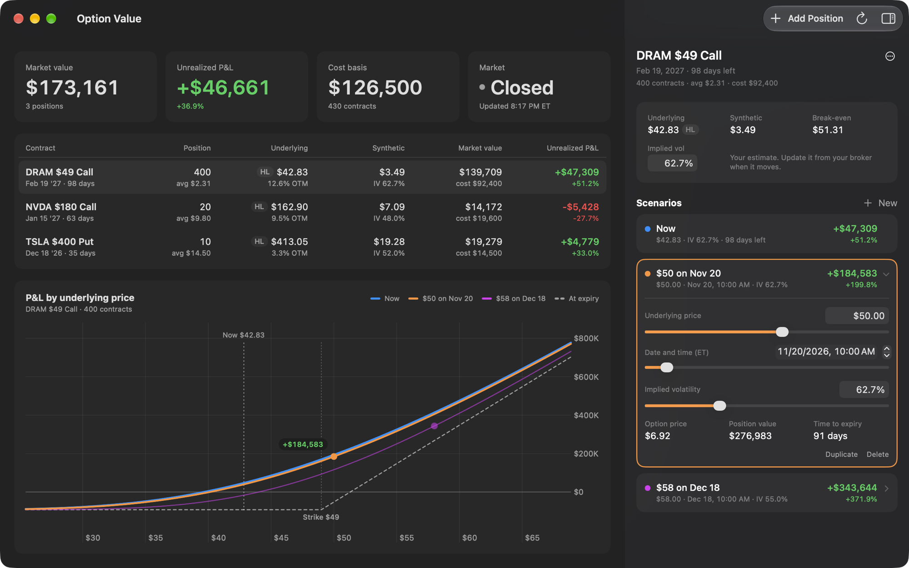
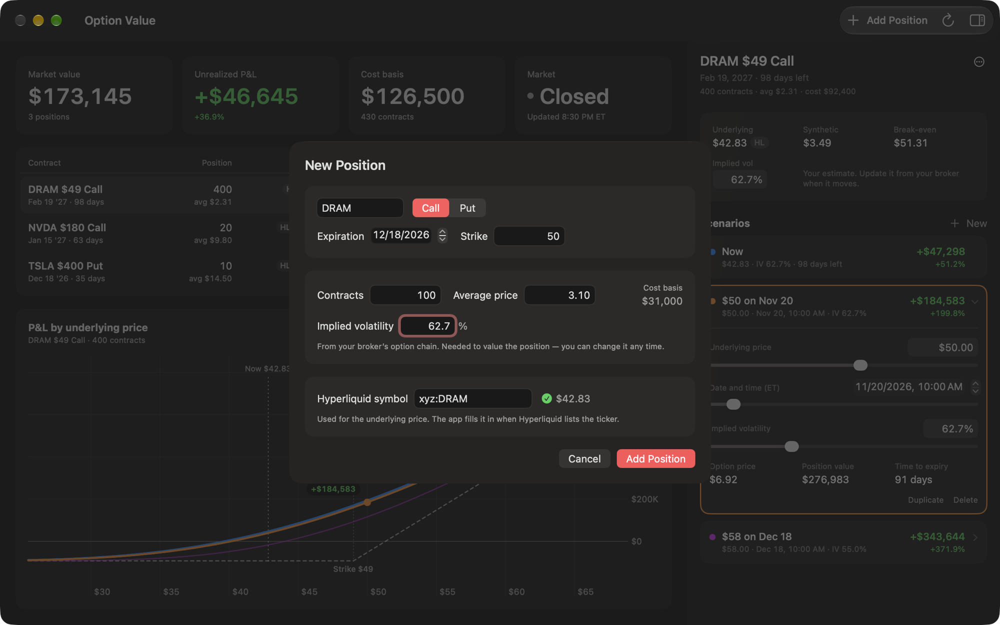
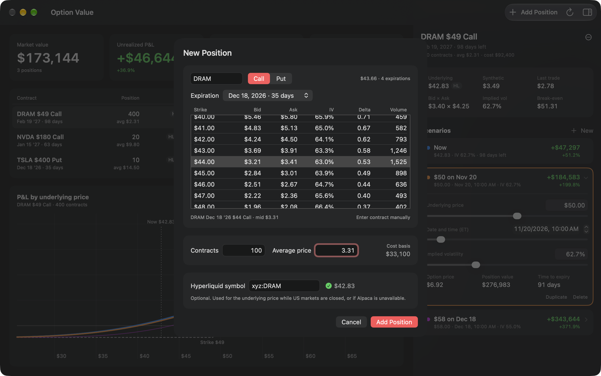

# Option Value

A native macOS app that shows what your option positions are worth right now, and what they would be
worth at any price, date and volatility.



It needs no account. Underlying prices come from [Hyperliquid](https://hyperliquid.xyz)'s public API
(around the clock, including when US markets are closed), and you type in the contract and its implied
volatility. If you have [Alpaca](https://alpaca.markets) API keys, the app also gets live option quotes,
implied volatility and option chains.

## What it does

- **Dashboard.** Every saved position with its size, average price, cost basis, the underlying's price,
  the option's *synthetic* value (a Black-Scholes fair value from the current price and IV), market value
  and unrealized P&L, plus totals across all positions.
- **Scenarios.** "What is this worth if the stock is at $50 on November 20?" Drag sliders for price, date
  and implied volatility and watch the value and the chart change. Scenarios are saved with the position.
- **P&L chart.** Profit and loss across underlying prices: today, at expiry, and in each scenario.
- **Everything is saved** on your Mac between launches.

| Adding a position by hand | With Alpaca keys: the option chain |
|---|---|
|  |  |

Light mode is supported too: [screenshot](screenshots/dashboard-light.png).

## Requirements

- macOS 15 or later.
- Xcode to build it.

It was built and tested with Xcode 27 on macOS 27. The deployment target is macOS 15 and the code is
Swift 6, so Xcode 16 or later should work, but older versions and older systems have not been tested.

## Build and run

Clone the repo, open `OptionValue.xcodeproj` in Xcode and press Run.

Or from the terminal:

```bash
xcodebuild -project OptionValue.xcodeproj -scheme OptionValue -configuration Release -derivedDataPath build build
cp -R build/Build/Products/Release/OptionValue.app /Applications/
```

If `xcodebuild` says it "requires Xcode", point the command line tools at Xcode first:
`sudo xcode-select -s /Applications/Xcode.app`.

To look around with sample data before entering anything of your own:

```bash
open -n /Applications/OptionValue.app --args -demo YES
```

## Using it without an Alpaca key

1. Click **Add Position** and enter the ticker, call or put, expiration, strike, number of contracts and
   the average price you paid per share.
2. Enter the contract's **implied volatility** from your broker's option chain. The app needs it to value
   the position; you can change it at any time in the sidebar.
3. The app looks the ticker up on Hyperliquid and fills in its symbol (for example `xyz:NVDA`). From then
   on the position is valued with the live Hyperliquid price.

Things to know:

- Hyperliquid lists most large US stocks, but not every ticker. SPY and QQQ, for example, were not listed
  in November 2026. A position on an unlisted ticker can still be saved and used for scenarios, but the
  dashboard cannot value it without Alpaca keys.
- The implied volatility you type stays until you change it, so update it when the market moves.
- Hyperliquid prices are for perpetual futures that track the stock. They follow it closely but are not
  the stock's own last trade.
- Each position is one long contract type (one strike and one expiration). A spread is entered as
  separate positions, and short positions are not supported.

## Optional: Alpaca keys

Open **Settings** (⌘,) and paste an Alpaca API key ID and secret. Paper-trading keys are enough. This adds:

- live option quotes (bid, ask, last trade) and implied volatility for your contracts;
- an option-chain browser when adding a position, so you pick the expiration and strike instead of
  typing them;
- stock prices for any ticker, and the real market calendar.

With keys, the underlying price comes from Alpaca while US markets trade (pre-market, regular hours and
after hours) and from Hyperliquid when they are closed.

## How values are calculated

- **Model.** Black-Scholes, with the risk-free rate from Settings (4.3% by default) and no dividends.
  Early exercise is not modelled, so deep in-the-money American puts are slightly undervalued.
- **Time.** Options are treated as expiring at 4:00 PM Eastern on their expiration date. All dates and
  times in the app are Eastern.
- **Synthetic value.** The model's value right now, from the current underlying price and the contract's
  implied volatility: the live one from Alpaca when available, otherwise the one saved with the position.
- **Scenarios** use the price, date and implied volatility you set, so they do not predict how implied
  volatility itself will change.

These are estimates, not quotes. Nothing here is financial advice.

## Your data

- Positions and scenarios are stored on your Mac in `~/Library/Application Support/OptionValue/`.
- Settings, including Alpaca keys if you enter them, are stored in the app's preferences on your Mac.
  They are not encrypted, which is one reason to use paper-trading keys.
- The app talks only to `api.hyperliquid.xyz` and, if you entered keys, to Alpaca. There is no telemetry.

## Development

The Xcode project is generated from `project.yml` with [XcodeGen](https://github.com/yonaskolb/XcodeGen).
After adding or removing files, run `xcodegen generate`.

Run the tests (the network is stubbed, and your saved data is never touched):

```bash
Tests/run.sh
```

Launch arguments, passed after `--args`:

| Argument | Effect |
|---|---|
| `-demo YES` | Sample positions in memory and canned market data. Nothing is read from or written to disk, and there is no network access. |
| `-demoKeys NO` | With `-demo YES`: behave as if no Alpaca keys were entered. |
| `-demoEmpty YES` | With `-demo YES`: start with no positions. |
| `-demoAppearance light` or `dark` | Force the color scheme in demo and ephemeral mode. |
| `-ephemeral YES` | A clean slate with the real network: an empty in-memory store, and saved settings are neither read nor written. |

Where things are:

| File | Contents |
|---|---|
| `Pricing.swift` | Black-Scholes and the Eastern-time helpers |
| `Models.swift` | `Position` and `Scenario` (SwiftData) |
| `Hyperliquid.swift`, `AlpacaClient.swift` | The two data sources |
| `MarketData.swift` | Which price and IV to use, and `MarketStore`, the app's shared state |
| `Theme.swift` | Colors, number formats and small shared views |
| `DashboardView.swift` | The window: summary tiles, positions, chart, sidebar |
| `PortfolioHeader.swift`, `PositionsList.swift`, `PayoffChart.swift` | The dashboard's cards |
| `PositionInspector.swift`, `ScenarioCard.swift` | The sidebar and its scenarios |
| `PositionEditor.swift` | The New / Edit Position sheet |
| `SettingsView.swift`, `DemoData.swift` | Settings, and demo and ephemeral mode |
| `OptionValueApp.swift` | The app's entry point: the window, Settings and where positions are stored |

The app icon is drawn in `AppIcon.svg`; `make_icon.sh` renders it into the asset catalog (it needs
`librsvg`).

## License

[MIT](LICENSE)
